<p align="center">
  
</p>

<p align="center">
  <a href="https://github.com/offensiveadhd/codeql-mrva/actions/workflows/test.yml"></a>
  
  <a href="https://agentskills.io"></a>
  
  
  <a href="LICENSE"></a>
</p>

<p align="center">
  <a href="#see-it-run">See it run</a> ·
  <a href="#how-it-works">How it works</a> ·
  <a href="#what-the-skill-teaches-the-agent">What it teaches</a> ·
  <a href="#install">Install</a> ·
  <a href="#quick-start">Quick start</a> ·
  <a href="#scripts">Scripts</a> ·
  <a href="#limits-that-bite">Limits</a> ·
  <a href="skills/codeql-mrva/SKILL.md">SKILL.md</a>
</p>

An agent skill for GitHub's **multi-repository variant analysis** (MRVA): run one CodeQL query
across up to 1,000 repositories at once, then turn the results into confirmed, responsibly
reported vulnerabilities. One skill folder, installable into **Claude Code**, **Hermes Agent** and
**OpenAI Codex**, and into any other agent that reads the [Agent Skills](https://agentskills.io)
format.

MRVA was introduced by GitHub in March 2023
([blog post](https://github.blog/security/vulnerability-research/multi-repository-variant-analysis-a-powerful-new-way-to-perform-security-research-across-github/)).
You give it a CodeQL query pack and a list of repositories; a GitHub Actions workflow in a
*controller repository* you own runs the query against the CodeQL database GitHub already stores
for each repository's default branch, and streams SARIF back as each job finishes. Nothing is
cloned or built on your machine.

## See it run

<p align="center">
  <a href="docs/demo/session.md"></a>
</p>

One real session, recorded on 2026-11-26: the whole loop from target list to triage, on the top
20 Python repositories. The query is a harmless demo,
[`NaiveUtcCalls.ql`](docs/demo/pack/NaiveUtcCalls.ql), which finds every call to
`datetime.utcnow()` and `datetime.utcfromtimestamp()` (deprecated since Python 3.12), so the run
points at nobody's vulnerability. Every line on screen is real output; some lines are left out
and marked, and the 4 min 33 s the controller took is skipped. Select the picture for the
[full transcript](docs/demo/session.md). The pack, the lists and the recorder are in
[docs/demo](docs/demo).

Two things the run shows. The code search for `utcnow` counted a hit in `anthropics/skills`; the
query found none there, because that match sits inside a string. And the query found a
`utcfromtimestamp()` call in stable-diffusion-webui that a search for `utcnow` cannot see.

## How it works

<p align="center">
  
</p>

The skill runs in two shapes. Hosted, the agent submits through `gh mrva`, the VS Code CodeQL
extension or the REST API, and GitHub Actions in your controller repository does the work. Local,
for small lists or offline work, it downloads the stored databases and runs `codeql` itself, with
the same pack and the same triage.

<details>
<summary>The two shapes as a text diagram</summary>

```
 hosted: GitHub runs the query

  agent + skill              controller repo                stored databases
 ┌───────────────┐  submit  ┌──────────────────┐  fan out  ┌──────────────────────┐
 │ query pack    │─────────►│ GitHub Actions,  │──────────►│ one CodeQL database  │
 │ repo list     │◄─────────│ one job per repo │◄──────────│ per repository       │
 └───────────────┘  SARIF   └──────────────────┘  results  └──────────────────────┘
        │
        ▼
  mrva_sarif.py: triage table, hits list ──► re-run on hits ──► private report

 local: under about 50 repositories, no controller

  mrva_dbs.py --download --extract ──► codeql database analyze ──► mrva_sarif.py
```

</details>

## What the skill teaches the agent

The loop that makes MRVA useful instead of noisy:

1. **Frame the variant**: sink, source and barrier, from the CVE or the fix commit.
2. **Write the query as a pack**, sink-only first, then taint tracking
   (`TaintTracking::Global<Config>` skeletons for Python, Java, JavaScript, Go, Ruby, C/C++).
3. **Test on one to three downloaded databases** before scaling.
4. **Build the target list**: top-N by stars, an org, a code search, dependents; then keep only
   repositories that have a CodeQL database.
5. **Set up the controller repository** once: public or private, Actions billing, self-hosted
   runners.
6. **Submit** from VS Code, from `gh mrva`, or straight against the REST API.
7. **Triage SARIF like a reviewer**: per-rule sanity, prioritisation, confirmation at the analysed
   commit, false-positive categories that feed back into the query, a re-run on the hits only.
8. **Report** through private vulnerability reporting, one report per repository, with a 90-day
   timeline, upstream first for shared root causes.

Plus the limits that bite (below) and the fully local alternative: databases downloaded through
the API, or Trail of Bits' `mrva`.

## Install

### Claude Code

```bash
claude plugin marketplace add offensiveadhd/codeql-mrva
claude plugin install codeql-mrva@codeql-mrva
```

Or copy the skill folder into `~/.claude/skills/` (personal) or `.claude/skills/` (project), or run
`npx skills add offensiveadhd/codeql-mrva -a claude-code -g`. Invoke it with `/codeql-mrva`, or let
it trigger on MRVA and variant-analysis requests.

### Hermes Agent

```bash
hermes skills install offensiveadhd/codeql-mrva/skills/codeql-mrva --category security
```

Or copy the folder into `~/.hermes/skills/security/` (Windows:
`%LOCALAPPDATA%\hermes\skills\security\`), or project-local under `./.hermes/skills/` followed by
`hermes skills trust`. Hermes profiles have their own skills tree: `hermes -p NAME skills install ...`,
or the installers below with `--hermes-profile default,NAME` / `-HermesProfile default,NAME`.
Invoke it with `/codeql-mrva <request>`.

### Codex

```bash
npx skills add offensiveadhd/codeql-mrva -a codex -g
```

Or copy the folder into `~/.agents/skills/` (user) or `.agents/skills/` (project). The repository
also carries `.codex-plugin/plugin.json` and `.agents/plugins/marketplace.json`, so
`codex plugin marketplace add offensiveadhd/codeql-mrva` registers it as a plugin marketplace.
Invoke it with `$codeql-mrva`.

### All three at once

```bash
git clone https://github.com/offensiveadhd/codeql-mrva
bash codeql-mrva/install.sh                 # finds Claude Code, Hermes, Codex; copies into each
bash codeql-mrva/install.sh --link          # links instead, so git pull updates all of them
pwsh codeql-mrva/install.ps1                # native Windows (or: powershell -ExecutionPolicy Bypass -File install.ps1)
npx skills add offensiveadhd/codeql-mrva --agent '*' -g -y   # or the skills CLI
```

The tools the skill drives are the GitHub CLI, the CodeQL CLI, the `gh-mrva` extension and,
optionally, the VS Code CodeQL extension. Install steps for each are in
[references/install.md](skills/codeql-mrva/references/install.md).

## Quick start

The recorded session, as commands you can run from a clone of this repository. Replace `OWNER`
with your user or organisation.

```bash
S=skills/codeql-mrva/scripts
bash   $S/mrva_controller.sh OWNER/mrva-controller                        # once; public = public targets, free

# 1. the target list, kept to repositories that have a database
python $S/mrva_list.py top --language python --limit 20 --name py-top20 --out databases.json
python $S/mrva_dbs.py --file databases.json --list py-top20 --language python \
    --max-db-mb 100 --write-list demo --out databases.json

# 2. the query, tested on one database
codeql pack install docs/demo/pack                                        # resolves codeql/python-all once
python $S/mrva_dbs.py AUTOMATIC1111/stable-diffusion-webui --language python --download dbs/ --extract
codeql database analyze dbs/AUTOMATIC1111__stable-diffusion-webui__python \
    docs/demo/pack/NaiveUtcCalls.ql --format=sarif-latest --output=one.sarif
python $S/mrva_sarif.py one.sarif

# 3. the variant analysis
gh extension install GitHubSecurityLab/gh-mrva
gh mrva submit --controller OWNER/mrva-controller --language python --session demo-1 \
    --list demo --list-file databases.json --query docs/demo/pack/NaiveUtcCalls.ql
gh mrva status   --session demo-1                                         # until Status: succeeded
gh mrva download --session demo-1 --output-dir results/demo-1

# 4. triage, and a hits list to re-run the refined query on
python $S/mrva_sarif.py results/demo-1 --repo-list hits --out databases.json > triage.md
```

For your own variant, copy [`assets/qlpack-template/`](skills/codeql-mrva/assets/qlpack-template)
and start from its sink-only query. On Windows, `gh mrva` needs `codeql.exe` itself on `PATH`
(gh-codeql's `dist/release/v<version>` folder), not the `codeql` shell wrapper.

## Scripts

Python 3.9+ with the standard library only. Every remote call goes through the GitHub CLI, so your
existing `gh auth login` is the only credential.

| Script | Does |
|---|---|
| [`mrva_list.py`](skills/codeql-mrva/scripts/mrva_list.py) | Build lists from top-N by stars, an owner, a code search or files; merge, dedupe, cap, chunk; convert between the gh-mrva and VS Code formats |
| [`mrva_dbs.py`](skills/codeql-mrva/scripts/mrva_dbs.py) | Which repositories have a CodeQL database (per language, size, age); resolve renames; filter a list to them; download and extract databases |
| [`mrva_sarif.py`](skills/codeql-mrva/scripts/mrva_sarif.py) | Summarise SARIF from `gh mrva download` or local runs into a triage table, JSON, and a hits list |
| [`mrva_controller.sh`](skills/codeql-mrva/scripts/mrva_controller.sh) | Create the controller repository with its first commit; optional self-hosted runner labels |

<details>
<summary>Everything in the skill folder</summary>

```
skills/codeql-mrva/
├── SKILL.md                         the skill: workflow, limits, file map
├── references/
│   ├── how-mrva-works.md            architecture, REST API, billing, setting IDs
│   ├── vscode-workflow.md           click-by-click, databases.json schema, code-search lists
│   ├── gh-mrva-cli.md               install, config, every flag, output file naming
│   ├── local-variant-analysis.md    databases via API, Trail of Bits mrva, codeql CLI loop
│   ├── query-authoring.md           pack layout, metadata, per-language skeletons, precision tuning
│   ├── target-lists.md              building and filtering repository lists
│   ├── triage-and-disclosure.md     SARIF field map, triage order, tracker, disclosure
│   └── install.md                   Claude Code / Hermes / Codex install
├── scripts/
│   ├── mrva_list.py                 build, merge, chunk, convert repository lists (gh-mrva <-> VS Code)
│   ├── mrva_dbs.py                  which repos have a CodeQL database; filter; download + extract
│   ├── mrva_sarif.py                SARIF directory -> triage markdown / JSON / hits list
│   └── mrva_controller.sh           create the controller repository with its first commit
└── assets/
    ├── qlpack-template/             qlpack.yml + sink-only and path-problem example queries
    ├── databases.example.json       gh-mrva list format
    └── gh-mrva.config.example.yml   gh-mrva configuration
```

Outside the skill folder: [`docs/demo/`](docs/demo) (the recorded session and its query pack),
[`tests/`](tests), the installers and the plugin manifests.

</details>

## Limits that bite

- **1,000 repositories per run**, one language per run, default branch only, and only
  repositories that already have a stored CodeQL database; the rest are skipped, not analysed.
  `mrva_dbs.py` tells you before you submit.
- **The slowest database sets the wall time.** One large database holds up the whole run;
  `mrva_dbs.py --max-db-mb` drops it.
- **A public controller's Actions logs are public.** Anyone can read each job's log, which names
  the query, prints its description and shows the result count per repository, for as long as the
  repository keeps logs (90 days by default). A public controller is free and may only analyse
  public repositories; run unpublished research from a private one, or delete the runs once the
  results are downloaded.
- **Renamed repositories are skipped as "not found"**: MRVA does not follow GitHub redirects.
  `mrva_dbs.py` writes every repository under its current name.
- **The pack is compiled remotely** with the action's CodeQL version. Depend on
  `codeql/<lang>-all` with a range, not an exact old version.
- **Stored databases can be months old.** Confirm against the current code before reporting.

The full list, with the workarounds, is in [SKILL.md](skills/codeql-mrva/SKILL.md#limits-and-gotchas).

## Tests

```bash
python -m pip install pytest
python -m pytest -q
```

The tests cover list parsing and conversion, SARIF summarising and the scripts' command lines;
nothing in them touches the network. CI runs them on Ubuntu and Windows with Python 3.9 and 3.12.

<details>
<summary>Sources</summary>

- GitHub blog, 9 March 2023: [Multi-repository variant analysis: a powerful new way to perform security research across GitHub](https://github.blog/security/vulnerability-research/multi-repository-variant-analysis-a-powerful-new-way-to-perform-security-research-across-github/)
- GitHub Docs: [About multi-repository variant analysis](https://docs.github.com/en/code-security/concepts/code-scanning/multi-repository-variant-analysis), [Running CodeQL queries at scale with MRVA](https://docs.github.com/en/code-security/how-tos/scan-code-for-vulnerabilities/scan-from-vs-code/running-codeql-queries-at-scale-with-multi-repository-variant-analysis), [Code scanning REST API](https://docs.github.com/en/rest/code-scanning/code-scanning)
- GitHub changelog, June 2023: [Use GitHub code search to support security research with MRVA](https://github.blog/changelog/2023-06-23-use-github-code-search-to-support-security-research-with-multi-repostiory-variant-analysis-for-codeql-beta/)
- [GitHubSecurityLab/gh-mrva](https://github.com/GitHubSecurityLab/gh-mrva), [github/codeql-variant-analysis-action](https://github.com/github/codeql-variant-analysis-action), [github/vscode-codeql](https://github.com/github/vscode-codeql)
- [GitHubSecurityLab/CodeQL-Community-Packs](https://github.com/GitHubSecurityLab/CodeQL-Community-Packs), [trailofbits/mrva](https://github.com/trailofbits/mrva)
- Skill formats: [Claude Code skills](https://code.claude.com/docs/en/skills), [Hermes Agent skills](https://hermes-agent.nousresearch.com/docs/user-guide/features/skills), [Codex skills](https://developers.openai.com/codex/skills), [agentskills.io](https://agentskills.io)

</details>

## License

MIT. The example queries are illustrations; check them against your CodeQL CLI version before
relying on them.
